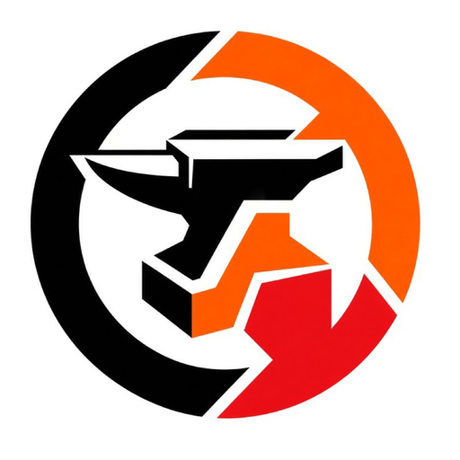

<div align="center">
  
  <h1>Anvil Browser</h1>
  <p>A small desktop browser Proof of Concept (PoC), written from scratch in Rust, C++20, and JavaScript.</p>
  <p>
    
    
    
    
    <a href="./SECURITY.md"></a>
    <a href="./LICENSE"></a>
  </p>
</div>

Version 0.19. Author: Buntos.

Anvil Browser loads HTML, applies a CSS cascade, lays the page out, and paints it into a CPU RGBA buffer. Windows can upload that finished buffer to Direct3D 11. Linux copies it with X11. The page is rasterized on the CPU either way.

There are no crates.io dependencies. The engine crates live in this repository. Seven companion libraries sit beside it and are linked by path.

## Download

The source tree is 0.19. The Windows files on the [v.18 release](https://github.com/buntatoes/anvil-browser/releases/tag/v.18) are the previous build. A 0.19 Windows build is not attached.

| File | What it is |
| --- | --- |
| `AnvilBrowser-Setup-v.18-win64.exe` | One setup program. It installs, and it uninstalls with `--uninstall`. |
| `anvil.exe` | The browser by itself, with no installer. |

SHA-256 checksums are in the release notes. The setup program is not required to build from source.

## What a page can do

- HTML is parsed into one tree. Selectors, forms, images, and video elements are read from that tree.
- CSS covers the cascade and media queries. `width`, `height`, `max-width`, and offsets keep `px`, `%`, `em`, and `rem`. Any other unit becomes `auto`.
- `font-size` accepts those same four units. `%` and `em` use the parent font size. `rem` uses the `html` font size, which is 16px until `html` sets one. Margin, padding, border, and `gap` still accept only `px` and `0`.
- A percentage width uses the containing block width. A percentage height uses the containing block height when that height is set, and is `auto` when it is not.
- Layout covers block, inline, flex, table, and positioned boxes. `flex-wrap: wrap` starts another line. `flex-grow` shares positive free space on each line and does not shrink. Column flex does not wrap or grow.
- The display list is painted into an RGBA framebuffer. Shadows, rounded boxes, and gradients go through `anvil-gpu`'s software draw device. Square fills, text, glyphs, and ordinary images stay on the existing path. Optional C++20 code still fills scanlines, glyph coverage, and NV12 rows when `cl.exe`, `g++`, or `clang++` is on `PATH`.
- Script runs in a budgeted Rust interpreter. A numeric `while` or `for` with no objects, calls, or property reads is compiled to x86-64 and the numbers are written back, so a later DOM write can use them. A whole script with no DOM, `fetch()`, or storage can also take that path. Anything else stays on the interpreter. This is not a general compiler. The caller owns the VM context.
- `fetch()` is same-origin only. A cross-origin URL returns status 403 and does not connect. The interpreter keeps at most 64 KiB of the body. The numeric VM does not perform `fetch()`.
- `localStorage` and `sessionStorage` are partitioned by origin. Each origin may store 64 KiB of key and value bytes. A write past that cap leaves the previous value in place. `sessionStorage` dies with the tab.
- HTTP/1.1 GET and POST, TLS, cookies, HSTS, CSP, CORP, and SHA-256 subresource checks go through `anvil-net`. A short list of host names is blocked before connect.
- An http or https load starts one `--tab-worker` process and waits 5 seconds for one `ANVILIPC` frame. The window paints the document from that frame and does not run those scripts again. A timeout or a bad frame shows an error page. `anvil://` pages and local files stay in the window process. The worker does not receive the session cookie jar or `localStorage`. This is not a multi-process sandbox.

Built-in pages are `anvil://home`, `anvil://settings`, `anvil://security`, `anvil://history`, `anvil://downloads`, and `anvil://inspect`. `frontend/` is text with string replacements, plus the scripts in `frontend/scripts/`. It is not built by a Node toolchain.

## What this is not

- The page is not rasterized on a hardware GPU. Shadows, rounded boxes, and gradients use `anvil-gpu`'s software device, which matches the CPU compositor. Direct3D 11, when it is available, only presents the finished CPU buffer. If that device or `compositor.hlsl` fails to compile, Windows copies the same buffer with GDI.
- Video frames are decoded on the CPU. The decoded frame is then drawn through that same software device before the controls are painted. There is no GPU decoder. Encrypted samples are AES-128-CTR from `anvil-cipher`.
- `display: grid`, `var(--token)`, `ch`, `vw`, and `calc()` are not implemented.
- One OS process does not stay open for each tab.

Limits that are enforced in code are listed in [SECURITY.md](./SECURITY.md).

## Window

Linux draws with X11 and does HTTPS with OpenSSL (`libssl` / `libcrypto`). Windows uses the system window APIs, Schannel, and DPAPI.

On Linux the window sets `PR_SET_NO_NEW_PRIVS`, turns core dumps off, and tries a 2 GiB address-space cap. `--tab-worker` asks for 256 MiB and exits if that cap does not stick.

`profile.anvil` stores bookmarks, history, cookies, HSTS, settings, and origin-partitioned `localStorage`. Windows seals it with DPAPI. Linux seals it with AES-256-GCM. The Linux key file is `profile.key` in the same directory, mode 0600, written before the profile.

| Keys | Action |
| --- | --- |
| Ctrl+T / Ctrl+W | New tab / close tab |
| Ctrl+L | Address bar |
| Ctrl+R / F5 | Reload |
| Alt+Left / Alt+Right | Back / forward |
| Ctrl+F | Find |
| Ctrl+J / Ctrl+H | Downloads / history |
| F12 | Inspector on Windows |

## Source layout

| Path | What it is |
| --- | --- |
| `crates/anvil-dom` | HTML tree and selectors |
| `crates/anvil-style` | CSS cascade and media queries |
| `crates/anvil-layout` | Block, inline, flex, table, and positioned boxes |
| `crates/anvil-paint` | Display list and zoom |
| `crates/anvil-raster` | RGBA framebuffer. Shadows, rounded boxes, and gradients use the software draw device |
| `crates/anvil-script` | Budgeted script runtime and the numeric x86-64 compiler |
| `crates/anvil-net` | HTTP, TLS, and the host block list |
| `crates/anvil-sandbox` | Process limits and the `ANVILIPC` frame format |
| `crates/anvil-browser` | Window, pages, downloads, and `profile.anvil` |
| `frontend/` | Built-in page text and page scripts |

`anvil-dom`, `anvil-style`, `anvil-layout`, `anvil-paint`, `anvil-raster`, and `anvil-script` are Apache-2.0. `anvil-net`, `anvil-sandbox`, `anvil-browser`, `frontend/`, and `assets/anvil-mark.png` are all rights reserved. The text is in `LICENSE`, `LICENSE-APACHE`, `LICENSE-MPL`, and `LICENSE-PROPRIETARY`.

## Build

Clone this repository and the seven libraries below as sibling directories.

```text
../anvil-browser
../anvil-cipher
../anvil-compress
../anvil-image
../anvil-json
../anvil-ttf
../anvil-gpu
../anvil-video
```

Rust 1.85 or newer. A C++20 compiler is optional. If none is found, the C++ files are skipped and the Rust paths are used.

```text
cargo test
cargo run --release -p anvil-browser --bin anvil
```

```text
anvil [file or http/https/anvil URL]
anvil open [--width N] [--height N] [file or http/https/anvil URL]
anvil render [--width N] <file or http/https/anvil URL>
anvil raster [--width N] [--height N] <file or http/https/anvil URL> <output.ppm>
anvil install
anvil uninstall
```

`anvil install` copies the program into the per-user install directory. It does not download a second copy.

## Companion libraries

These are separate MPL-2.0 repositories. This browser does not vendor their source.

A new library is its own repository, cloned next to this one and linked by path, the same way as the seven below. It is not a crates.io crate. Linux may keep using system libraries such as X11. Nothing else is added from outside.

If a browser change needs a change in one of these libraries, that library change is tested, committed, and pushed to its own repository before the browser change is shipped. The browser is not shipped against a library edit that exists only on one machine. `cargo test` for every touched crate passes before either repository is updated.

Source, tests, and release notes do not contain keys, tokens, or personal data.

| Repository | What it is |
| --- | --- |
| [anvil-cipher](https://github.com/buntatoes/anvil-cipher) | AES-128, AES-256, CTR, AES-256-GCM |
| [anvil-compress](https://github.com/buntatoes/anvil-compress) | DEFLATE, zlib, gzip |
| [anvil-image](https://github.com/buntatoes/anvil-image) | PNG, JPEG, GIF, WebP, ICO, BMP, PPM |
| [anvil-json](https://github.com/buntatoes/anvil-json) | JSON |
| [anvil-ttf](https://github.com/buntatoes/anvil-ttf) | TrueType and OpenType |
| [anvil-gpu](https://github.com/buntatoes/anvil-gpu) | Software drawing of boxes, shadows, gradients, and NV12. `compositor.hlsl` is source text compiled by the browser on Windows |
| [anvil-video](https://github.com/buntatoes/anvil-video) | CPU frames in a small MP4 container. Plane conversion uses anvil-gpu |

## Author

Buntos ([@buntatoes](https://github.com/buntatoes))
